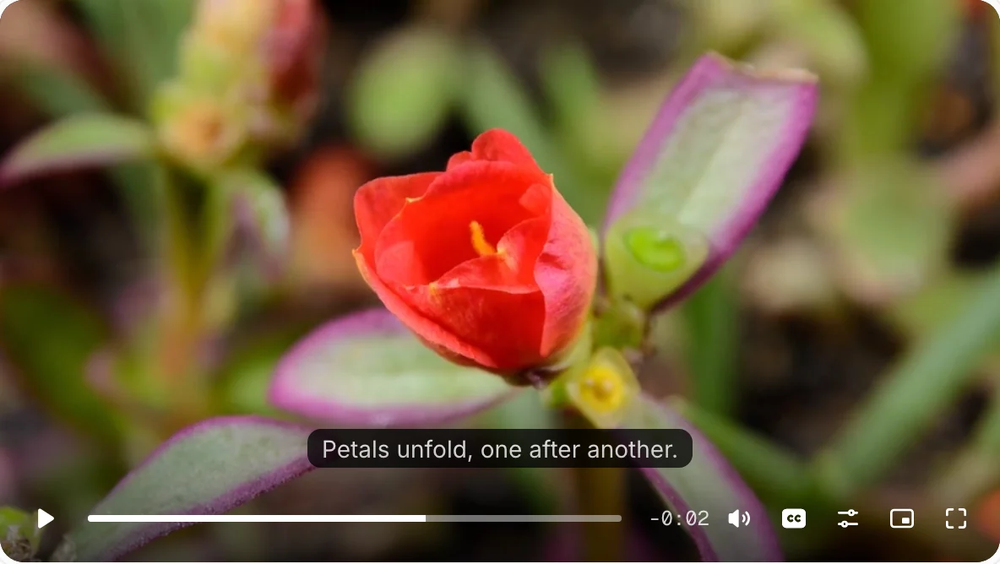
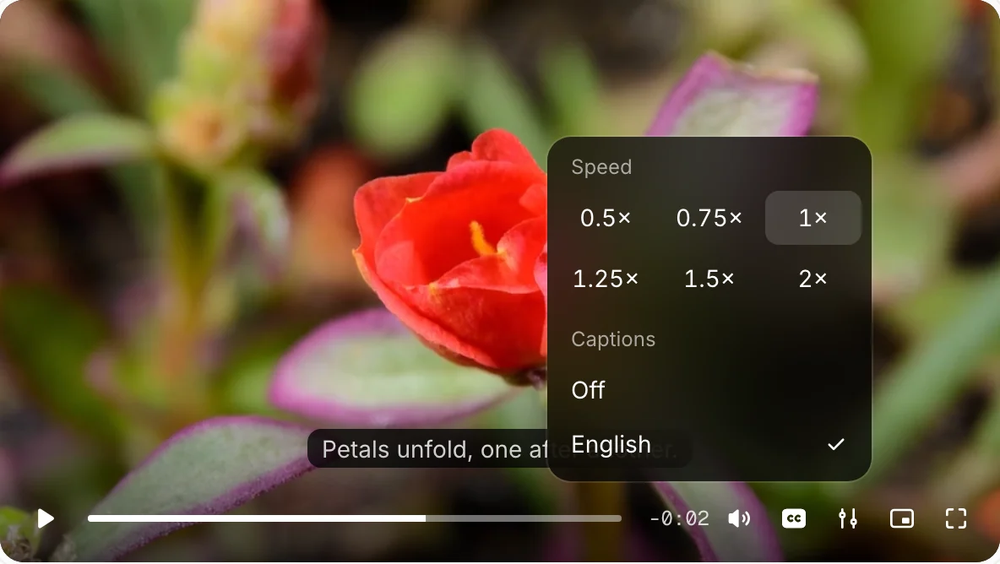
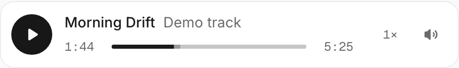

# bobine

Drop-in video and audio players for React. Swap `<video>` for `<VideoPlayer>` and keep every native prop.



Captions and playback speed share one settings menu:



`AudioPlayer` takes your theme tokens, so it matches your app in light and dark:

<picture>
  <source media="(prefers-color-scheme: dark)" srcset=".github/assets/audio-dark.webp">
  
</picture>

## Install

Copy the source into your project with the shadcn CLI:

```bash
npx shadcn@latest add https://bobine.fyi/r/video-player.json
```

Other items: `audio-player`, `media` (unstyled primitives), `media-hls` (HLS loader).

Or install the package:

```bash
pnpm add bobinejs
```

## Use

```tsx
import { VideoPlayer } from "@/components/ui/video-player"

<VideoPlayer src="/clip.mp4" poster="/clip.jpg" />
```

Full docs, live demos, parts and keyboard shortcuts are at [bobine.fyi/docs](https://bobine.fyi/docs). Package details are in [packages/bobine](packages/bobine/README.md).

## For agents

Install the skill so your coding agent knows the components, props and common mistakes:

```bash
npx skills add SanyamPunia/bobine
```

The skill lives in [skills/bobine](skills/bobine/SKILL.md). The site also serves:

- [`/llms.txt`](https://bobine.fyi/llms.txt): index of the docs and registry
- [`/llms-full.txt`](https://bobine.fyi/llms-full.txt): the full docs in one file
- [`/docs.md`](https://bobine.fyi/docs.md): the docs page as Markdown

## Develop

```bash
pnpm install
pnpm dev     # site on localhost:3000
pnpm test    # vitest
pnpm build   # registry JSON, then the Next.js build
```

## License

MIT
